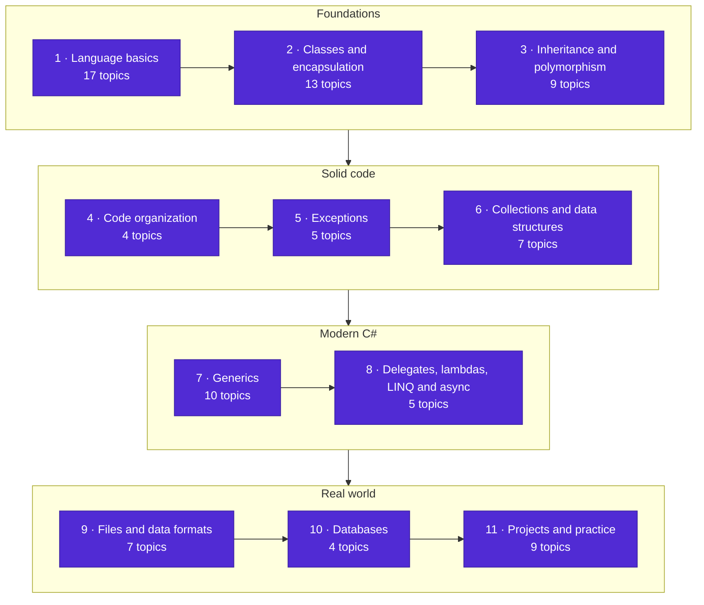
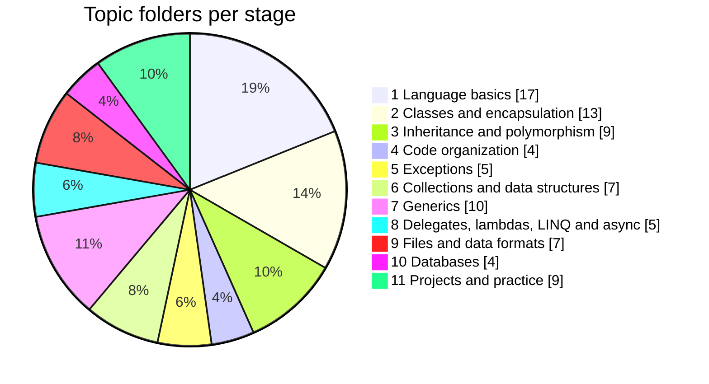
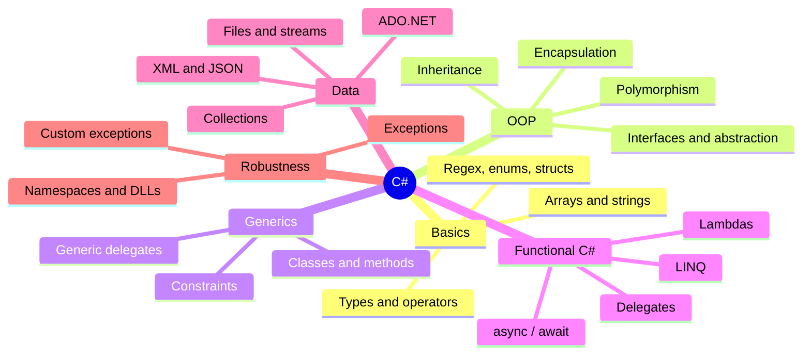

<p align="center">
  
</p>

<p align="center"><b>English</b> &nbsp;·&nbsp; <a href="README.sr.md">Srpski</a></p>

<p align="center">
  <a href="#pick-your-route">Pick your route</a> &nbsp;·&nbsp;
  <a href="#the-path-at-a-glance">The path</a> &nbsp;·&nbsp;
  <a href="#stage-by-stage">Stage by stage</a> &nbsp;·&nbsp;
  <a href="#projects">Projects</a> &nbsp;·&nbsp;
  <a href="#getting-started">Getting started</a>
</p>

<p align="center">
  
  
  
  
  
  <a href="LICENSE"></a>
</p>

This repository is my complete C# learning path in one place: every topic I worked through, with the exercises and small applications I wrote along the way. It starts at variables and loops and ends at generics, LINQ, async/await and database access.

The content of the files is in **Serbian**. Folder names are in **English**, so the structure is easy to follow whether you read one language or the other.

<table align="center">
  <tr>
    <td align="center" width="25%"><h2>90</h2>topic folders</td>
    <td align="center" width="25%"><h2>11</h2>learning stages</td>
    <td align="center" width="25%"><h2>9</h2>console apps and practice</td>
    <td align="center" width="25%"><h2>SR + EN</h2>languages</td>
  </tr>
</table>

## Pick your route

The folders are not numbered, so the stages below give them an order. Where you start depends on where you are.

| If you are... | Start here |
| --- | --- |
| **New to programming** | Go through stages 1, 2 and 3 in order, then try the console apps in [Projects](#projects). |
| **Coming from Java, C++ or Python** | Skim stage 1. The parts where C# differs most are [`Automatic property`](Automatic%20property), [`Generic-Constraints`](Generic-Constraints), [`linq`](linq) and [`Async and Await - asynchronous programming`](Async%20and%20Await%20-%20asynchronous%20programming). |
| **Already writing C#** | Use it as a reference. [`IEnumerator`](IEnumerator), [`Generic delegates`](Generic%20delegates), [`Operator overloading c#`](Operator%20overloading%20c%23) and [`Partial classes`](Partial%20classes) are good places to refresh a detail. |

> Tip: on the repository page press `t` to open GitHub's file finder and jump straight to a topic by name.

## The path at a glance



How the 90 topics are distributed:



And the concepts the path covers:



## Stage by stage

Every stage is collapsed to keep the page short. Open the ones you need.

<details>
<summary><b>1. Language basics</b> &nbsp;·&nbsp; 17 topics</summary>

<br>

Types, operators, methods, arrays, strings and the other building blocks everything else sits on.

| Folder | Topic |
| --- | --- |
| [`Datatypes c#`](Datatypes%20c%23) | Built-in value and reference types |
| [`Math class`](Math%20class) | The Math class and numeric helpers |
| [`bitwise operators`](bitwise%20operators) | Bitwise operators and bit manipulation |
| [`DateTime`](DateTime) | Working with dates and time |
| [`Methods c#`](Methods%20c%23) | Declaring and calling methods |
| [`Method Overloading c#`](Method%20Overloading%20c%23) | Same name, different signatures |
| [`Passing-Data-by-Value-and-Reference`](Passing-Data-by-Value-and-Reference) | Passing arguments by value and by reference |
| [`Arrays and loops`](Arrays%20and%20loops) | Arrays combined with loops |
| [`Arrays and operations`](Arrays%20and%20operations) | Common operations on arrays |
| [`Multidimensional arrays c#`](Multidimensional%20arrays%20c%23) | Multidimensional arrays |
| [`Strings c#`](Strings%20c%23) | String basics |
| [`Strings operations c#`](Strings%20operations%20c%23) | String manipulation |
| [`Regulas expressions`](Regulas%20expressions) | Regular expressions (Regex) |
| [`Enumerations c#`](Enumerations%20c%23) | Enums |
| [`Enumeration Exercises`](Enumeration%20Exercises) | Exercises with enums |
| [`Structs c#`](Structs%20c%23) | Structs and how they differ from classes |
| [`Struct for work with time`](Struct%20for%20work%20with%20time) | A struct that models time |

</details>

<details>
<summary><b>2. Classes and encapsulation</b> &nbsp;·&nbsp; 13 topics</summary>

<br>

Classes and objects, constructors, properties and how to keep an object's data safe.

| Folder | Topic |
| --- | --- |
| [`Classes and objects`](Classes%20and%20objects) | Defining classes and creating objects |
| [`Class operations`](Class%20operations) | Methods that work on a class's data |
| [`Class for work with strings`](Class%20for%20work%20with%20strings) | A custom class built around strings |
| [`Constructor overloading`](Constructor%20overloading) | Several constructors for one class |
| [`Copy constructors c#`](Copy%20constructors%20c%23) | Creating an object from another object |
| [`Keyword this c#`](Keyword%20this%20c%23) | The this keyword |
| [`Get and Set methods`](Get%20and%20Set%20methods) | Getters and setters |
| [`Automatic property`](Automatic%20property) | Auto-implemented properties |
| [`Data encapsulation`](Data%20encapsulation) | Hiding data behind a public interface |
| [`Static members and static classes`](Static%20members%20and%20static%20classes) | Static fields, methods and classes |
| [`Class composition c#`](Class%20composition%20c%23) | Building classes out of other classes |
| [`Operator overloading c#`](Operator%20overloading%20c%23) | Custom behavior for operators |
| [`Partial classes`](Partial%20classes) | One class split across several files |

</details>

<details>
<summary><b>3. Inheritance and polymorphism</b> &nbsp;·&nbsp; 9 topics</summary>

<br>

Reusing and extending code: inheritance, overriding, polymorphism, abstraction and interfaces.

| Folder | Topic |
| --- | --- |
| [`Inheritance`](Inheritance) | Base and derived classes |
| [`Inheritance and Members`](Inheritance%20and%20Members) | What derived classes inherit, and access modifiers |
| [`Inheritance types c#`](Inheritance%20types%20c%23) | Kinds of inheritance |
| [`Method overriding c#`](Method%20overriding%20c%23) | Overriding base-class methods |
| [`Polymorphism c# (static and dynamic)`](Polymorphism%20c%23%20%28static%20and%20dynamic%29) | Compile-time and run-time polymorphism |
| [`Abstraction c#`](Abstraction%20c%23) | Abstract classes and members |
| [`Intefaces`](Intefaces) | Interfaces |
| [`Sealed-Classes c#`](Sealed-Classes%20c%23) | Sealed classes |
| [`People-and-Students-OOP`](People-and-Students-OOP) | An OOP exercise with people and students |

</details>

<details>
<summary><b>4. Code organization</b> &nbsp;·&nbsp; 4 topics</summary>

<br>

Splitting code into namespaces, external classes and DLLs.

| Folder | Topic |
| --- | --- |
| [`Classes and DLL`](Classes%20and%20DLL) | Compiling classes into a reusable DLL |
| [`Intern namespace`](Intern%20namespace) | Namespaces inside a project |
| [`Extern classes`](Extern%20classes) | Using classes from outside the project |
| [`Extern (multi-file) namespace`](Extern%20%28multi-file%29%20namespace) | A namespace spread over several files |

</details>

<details>
<summary><b>5. Exceptions</b> &nbsp;·&nbsp; 5 topics</summary>

<br>

Handling errors properly: try/catch, using exceptions, writing custom ones.

| Folder | Topic |
| --- | --- |
| [`Exceptions c#`](Exceptions%20c%23) | Exception basics |
| [`Exception Handling`](Exception%20Handling) | try / catch / finally |
| [`Using exceptions`](Using%20exceptions) | Throwing and catching in practice |
| [`Custom-Exceptions`](Custom-Exceptions) | Writing your own exception types |
| [`Using exceptions with parameterized queries`](Using%20exceptions%20with%20parameterized%20queries) | Exceptions around parameterized SQL queries |

</details>

<details>
<summary><b>6. Collections and data structures</b> &nbsp;·&nbsp; 7 topics</summary>

<br>

Lists, dictionaries, sets and stacks, and how to iterate over them.

| Folder | Topic |
| --- | --- |
| [`Lists`](Lists) | List and the operations on it |
| [`Dictionary`](Dictionary) | Key–value collections |
| [`HashSet generic collection`](HashSet%20generic%20collection) | Sets of unique elements |
| [`Stack data structure`](Stack%20data%20structure) | The LIFO stack |
| [`Data-Structures-Introduction-Exercises`](Data-Structures-Introduction-Exercises) | Introductory data-structure exercises |
| [`Iteration through generic collections`](Iteration%20through%20generic%20collections) | foreach and other ways to iterate |
| [`IEnumerator`](IEnumerator) | How enumeration works under the hood |

</details>

<details>
<summary><b>7. Generics</b> &nbsp;·&nbsp; 10 topics</summary>

<br>

Generic classes, methods, interfaces, delegates and type constraints.

| Folder | Topic |
| --- | --- |
| [`Generic classes`](Generic%20classes) | Classes parameterized by type |
| [`Generic constructions`](Generic%20constructions) | Building blocks of generic code |
| [`Generic methods`](Generic%20methods) | Methods with type parameters |
| [`Generic lists`](Generic%20lists) | Generic list collections |
| [`Generic interfaces`](Generic%20interfaces) | Interfaces with type parameters |
| [`Generic interfaces Exercises`](Generic%20interfaces%20Exercises) | Exercises on generic interfaces |
| [`Generic delegates`](Generic%20delegates) | Delegates with type parameters |
| [`Generic-Constraints`](Generic-Constraints) | where constraints on type parameters |
| [`Generic-Constraints-Exercise`](Generic-Constraints-Exercise) | Exercises on constraints |
| [`Constraints-on-Type-Parameters`](Constraints-on-Type-Parameters) | More on constraining type parameters |

</details>

<details>
<summary><b>8. Delegates, lambdas, LINQ and async</b> &nbsp;·&nbsp; 5 topics</summary>

<br>

Functions as values, lambda expressions, querying data with LINQ and asynchronous code.

| Folder | Topic |
| --- | --- |
| [`Delegates c#`](Delegates%20c%23) | Delegates |
| [`Lambda expressions`](Lambda%20expressions) | Lambda expressions |
| [`linq`](linq) | Querying collections with LINQ |
| [`linq exercise c#`](linq%20exercise%20c%23) | LINQ exercises |
| [`Async and Await - asynchronous programming`](Async%20and%20Await%20-%20asynchronous%20programming) | Asynchronous programming with async/await |

</details>

<details>
<summary><b>9. Files and data formats</b> &nbsp;·&nbsp; 7 topics</summary>

<br>

Reading and writing text and binary files, streams, directories, XML and JSON.

| Folder | Topic |
| --- | --- |
| [`Textual files c#`](Textual%20files%20c%23) | Reading and writing text files |
| [`Binary-files-c#`](Binary-files-c%23) | Binary file I/O |
| [`Streams in c#`](Streams%20in%20c%23) | Streams |
| [`Directory-Operations`](Directory-Operations) | Working with directories |
| [`Basic XML Operations`](Basic%20XML%20Operations) | Reading and writing XML |
| [`Xml Exercises`](Xml%20Exercises) | XML exercises |
| [`Json-operations`](Json-operations) | Working with JSON |

</details>

<details>
<summary><b>10. Databases</b> &nbsp;·&nbsp; 4 topics</summary>

<br>

Connecting to a database, MSSQL connection strings, DataTable and DataSet.

| Folder | Topic |
| --- | --- |
| [`Database connection access`](Database%20connection%20access) | Connecting to a database |
| [`MSSQL connection string`](MSSQL%20connection%20string) | SQL Server connection strings |
| [`DataTable`](DataTable) | In-memory tables |
| [`DataSet`](DataSet) | Sets of related tables |

</details>

## Projects

The last stage pulls everything above together. These are the console applications and practice folders, and they are the quickest way to see how the individual topics fit into a working program.

| Folder | What it is |
| --- | --- |
| [`Book c# console app`](Book%20c%23%20console%20app) | A console app for managing books |
| [`Library — books and media console app`](Library%20%E2%80%94%20books%20and%20media%20console%20app) | A library of books and media (console) |
| [`Computer-Game-Exercise-console app`](Computer-Game-Exercise-console%20app) | A computer-game exercise (console) |
| [`Menu-Driven-Multipurpose-Calculator console app`](Menu-Driven-Multipurpose-Calculator%20console%20app) | A menu-driven multipurpose calculator |
| [`Mini console app c# - work with employees`](Mini%20console%20app%20c%23%20-%20work%20with%20employees) | A mini app for managing employees |
| [`Mini system for working with 3 students - console-app`](Mini%20system%20for%20working%20with%203%20students%20-%20console-app) | A mini system for three students |
| [`Wall Tile or Brick Calculator console app`](Wall%20Tile%20or%20Brick%20Calculator%20console%20app) | A tile / brick quantity calculator |
| [`TestTextApp`](TestTextApp) | A test app for working with text |
| [`Practice`](Practice) | Mixed practice exercises |

## Getting started

You need the [.NET SDK](https://dotnet.microsoft.com/download). Visual Studio or VS Code both work.

```bash
git clone https://github.com/MIhajloS07/csharp-learning-resources.git
cd csharp-learning-resources
```

Open a topic folder in your editor. If the folder contains a `.csproj` file, you can also run it from the terminal:

```bash
cd "Abstraction c#"
dotnet run
```

A suggestion for studying with it: read the code first, predict what it prints, run it, then change something and run it again. That is how most of it was written in the first place.

## Where to go next

This repository stops at the language and ADO.NET. Natural next steps, none of which are covered here:

- ASP.NET Core for web APIs and web apps
- Entity Framework Core instead of hand-written ADO.NET
- Unit testing with xUnit or NUnit
- Dependency injection, SOLID and common design patterns

## Contributing

Found a mistake, or have a cleaner solution to an exercise? Open an issue or a pull request. Typo fixes are welcome too.

## License and author

Released under the [MIT License](LICENSE). Written by [Mihajlo Stoiljković](https://github.com/MIhajloS07).

<p align="center">
  
</p>
