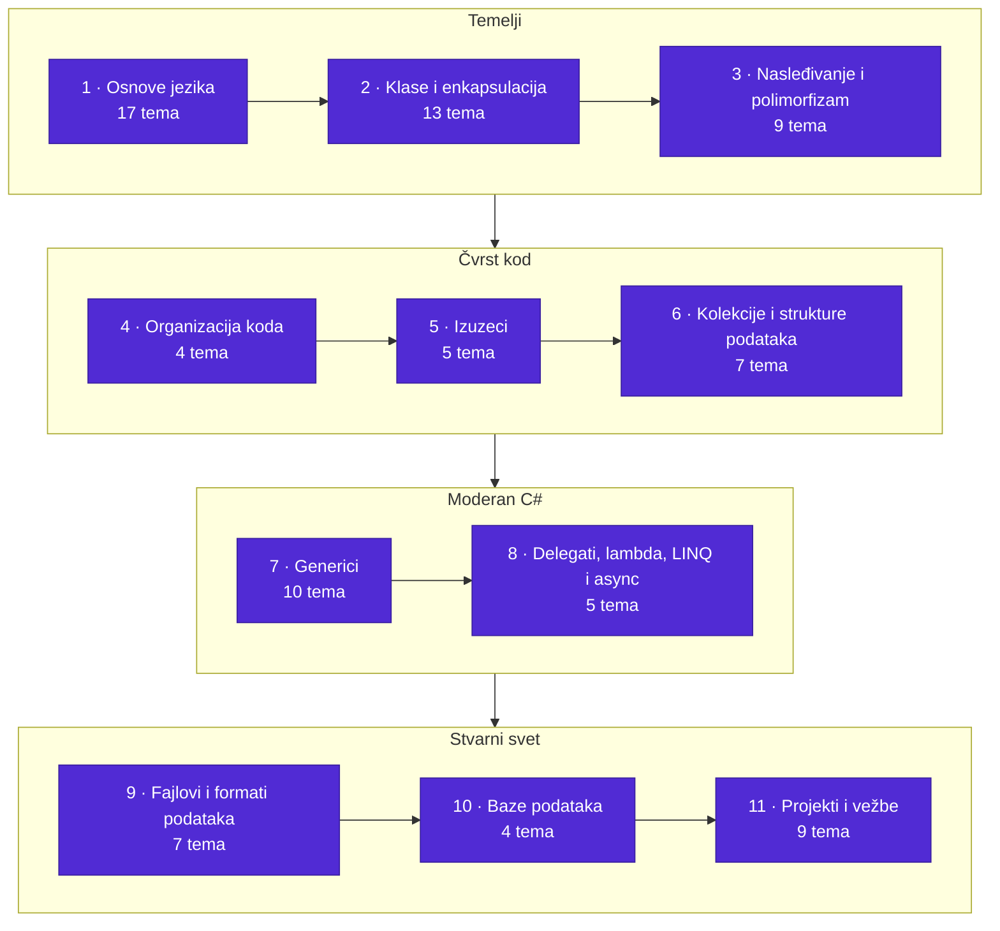
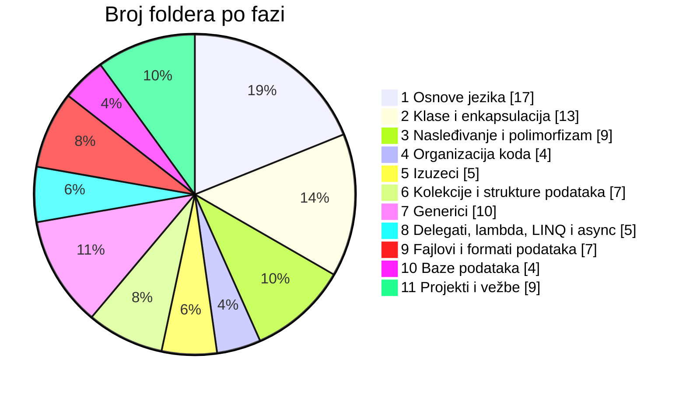
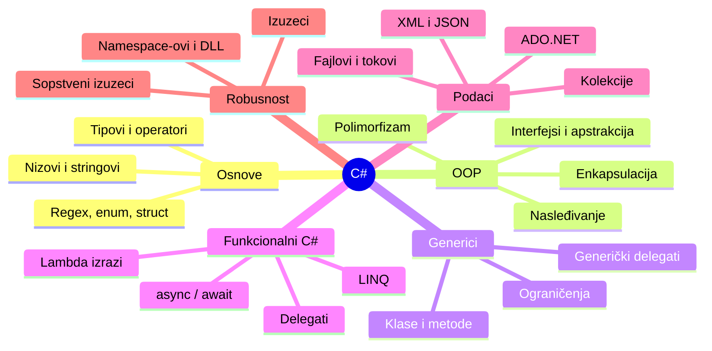

<p align="center">
  
</p>

<p align="center"><a href="README.md">English</a> &nbsp;·&nbsp; <b>Srpski</b></p>

<p align="center">
  <a href="#izaberi-svoj-put">Izaberi svoj put</a> &nbsp;·&nbsp;
  <a href="#pregled-puta">Pregled puta</a> &nbsp;·&nbsp;
  <a href="#faza-po-faza">Faza po faza</a> &nbsp;·&nbsp;
  <a href="#projekti">Projekti</a> &nbsp;·&nbsp;
  <a href="#pokretanje">Pokretanje</a>
</p>

<p align="center">
  
  
  
  
  
  <a href="LICENSE"></a>
</p>

Ovaj repozitorijum je ceo moj put kroz C# na jednom mestu: sve teme koje sam prošao, sa vežbama i malim aplikacijama koje sam usput pisao. Počinje od promenljivih i petlji, a završava se genericima, LINQ-om, async/await-om i radom sa bazom podataka.

Sadržaj fajlova je na **srpskom**. Imena foldera su na **engleskom**, tako da se struktura lako prati bez obzira na to koji jezik govoriš.

<table align="center">
  <tr>
    <td align="center" width="25%"><h2>90</h2>foldera sa temama</td>
    <td align="center" width="25%"><h2>11</h2>faze učenja</td>
    <td align="center" width="25%"><h2>9</h2>konzolnih aplikacija i vežbi</td>
    <td align="center" width="25%"><h2>SR + EN</h2>jezika</td>
  </tr>
</table>

## Izaberi svoj put

Folderi nisu numerisani, pa im faze ispod daju redosled. Odakle ćeš krenuti zavisi od toga gde si sada.

| Ako si... | Kreni odavde |
| --- | --- |
| **Početnik u programiranju** | Prođi faze 1, 2 i 3 redom, pa probaj konzolne aplikacije u [Projektima](#projekti). |
| **Dolaziš iz Jave, C++-a ili Pythona** | Preleti fazu 1. Najviše se C# razlikuje u: [`Automatic property`](Automatic%20property), [`Generic-Constraints`](Generic-Constraints), [`linq`](linq) i [`Async and Await - asynchronous programming`](Async%20and%20Await%20-%20asynchronous%20programming). |
| **Već pišeš C#** | Koristi ga kao podsetnik. [`IEnumerator`](IEnumerator), [`Generic delegates`](Generic%20delegates), [`Operator overloading c#`](Operator%20overloading%20c%23) i [`Partial classes`](Partial%20classes) su dobra mesta da osvežiš neki detalj. |

> Savet: na stranici repozitorijuma pritisni `t` da otvoriš GitHub-ov pretraživač fajlova i odmah skočiš na temu po imenu.

## Pregled puta



Raspodela 90 tema po fazama:



I koncepti koje put pokriva:



## Faza po faza

Svaka faza je zatvorena da bi stranica ostala kratka. Otvori one koje ti trebaju.

<details>
<summary><b>1. Osnove jezika</b> &nbsp;·&nbsp; 17 tema</summary>

<br>

Tipovi, operatori, metode, nizovi, stringovi i ostali gradivni blokovi na kojima počiva sve ostalo.

| Folder | Tema |
| --- | --- |
| [`Datatypes c#`](Datatypes%20c%23) | Ugrađeni tipovi podataka |
| [`Math class`](Math%20class) | Klasa Math i numeričke operacije |
| [`bitwise operators`](bitwise%20operators) | Bitovski operatori i rad sa bitovima |
| [`DateTime`](DateTime) | Rad sa datumima i vremenom |
| [`Methods c#`](Methods%20c%23) | Deklaracija i pozivanje metoda |
| [`Method Overloading c#`](Method%20Overloading%20c%23) | Isto ime, različiti potpisi |
| [`Passing-Data-by-Value-and-Reference`](Passing-Data-by-Value-and-Reference) | Prosleđivanje po vrednosti i po referenci |
| [`Arrays and loops`](Arrays%20and%20loops) | Nizovi i petlje |
| [`Arrays and operations`](Arrays%20and%20operations) | Najčešće operacije nad nizovima |
| [`Multidimensional arrays c#`](Multidimensional%20arrays%20c%23) | Višedimenzionalni nizovi |
| [`Strings c#`](Strings%20c%23) | Osnove stringova |
| [`Strings operations c#`](Strings%20operations%20c%23) | Operacije nad stringovima |
| [`Regulas expressions`](Regulas%20expressions) | Regularni izrazi (Regex) |
| [`Enumerations c#`](Enumerations%20c%23) | Enumeracije (enum) |
| [`Enumeration Exercises`](Enumeration%20Exercises) | Zadaci sa enumeracijama |
| [`Structs c#`](Structs%20c%23) | Strukture (struct) i razlika u odnosu na klase |
| [`Struct for work with time`](Struct%20for%20work%20with%20time) | Struktura za rad sa vremenom |

</details>

<details>
<summary><b>2. Klase i enkapsulacija</b> &nbsp;·&nbsp; 13 tema</summary>

<br>

Klase i objekti, konstruktori, svojstva i način da se podaci objekta zaštite.

| Folder | Tema |
| --- | --- |
| [`Classes and objects`](Classes%20and%20objects) | Definisanje klasa i kreiranje objekata |
| [`Class operations`](Class%20operations) | Metode koje rade nad podacima klase |
| [`Class for work with strings`](Class%20for%20work%20with%20strings) | Sopstvena klasa za rad sa stringovima |
| [`Constructor overloading`](Constructor%20overloading) | Više konstruktora za jednu klasu |
| [`Copy constructors c#`](Copy%20constructors%20c%23) | Kreiranje objekta na osnovu drugog objekta |
| [`Keyword this c#`](Keyword%20this%20c%23) | Ključna reč this |
| [`Get and Set methods`](Get%20and%20Set%20methods) | Get i Set metode |
| [`Automatic property`](Automatic%20property) | Automatska svojstva |
| [`Data encapsulation`](Data%20encapsulation) | Sakrivanje podataka iza javnog interfejsa |
| [`Static members and static classes`](Static%20members%20and%20static%20classes) | Statički članovi i statičke klase |
| [`Class composition c#`](Class%20composition%20c%23) | Klase sastavljene od drugih klasa |
| [`Operator overloading c#`](Operator%20overloading%20c%23) | Preopterećenje operatora |
| [`Partial classes`](Partial%20classes) | Jedna klasa podeljena na više fajlova |

</details>

<details>
<summary><b>3. Nasleđivanje i polimorfizam</b> &nbsp;·&nbsp; 9 tema</summary>

<br>

Ponovno korišćenje i proširivanje koda: nasleđivanje, redefinisanje metoda, polimorfizam, apstrakcija i interfejsi.

| Folder | Tema |
| --- | --- |
| [`Inheritance`](Inheritance) | Osnovne i izvedene klase |
| [`Inheritance and Members`](Inheritance%20and%20Members) | Šta izvedene klase nasleđuju i modifikatori pristupa |
| [`Inheritance types c#`](Inheritance%20types%20c%23) | Vrste nasleđivanja |
| [`Method overriding c#`](Method%20overriding%20c%23) | Redefinisanje metoda osnovne klase |
| [`Polymorphism c# (static and dynamic)`](Polymorphism%20c%23%20%28static%20and%20dynamic%29) | Statički i dinamički polimorfizam |
| [`Abstraction c#`](Abstraction%20c%23) | Apstraktne klase i članovi |
| [`Intefaces`](Intefaces) | Interfejsi |
| [`Sealed-Classes c#`](Sealed-Classes%20c%23) | Zapečaćene (sealed) klase |
| [`People-and-Students-OOP`](People-and-Students-OOP) | OOP vežba sa osobama i studentima |

</details>

<details>
<summary><b>4. Organizacija koda</b> &nbsp;·&nbsp; 4 tema</summary>

<br>

Podela koda na namespace-ove, spoljne klase i DLL biblioteke.

| Folder | Tema |
| --- | --- |
| [`Classes and DLL`](Classes%20and%20DLL) | Klase u višekratno upotrebljivoj DLL biblioteci |
| [`Intern namespace`](Intern%20namespace) | Namespace-ovi unutar projekta |
| [`Extern classes`](Extern%20classes) | Korišćenje klasa izvan projekta |
| [`Extern (multi-file) namespace`](Extern%20%28multi-file%29%20namespace) | Namespace raspoređen na više fajlova |

</details>

<details>
<summary><b>5. Izuzeci</b> &nbsp;·&nbsp; 5 tema</summary>

<br>

Pravilno rukovanje greškama: try/catch, korišćenje izuzetaka i pisanje sopstvenih.

| Folder | Tema |
| --- | --- |
| [`Exceptions c#`](Exceptions%20c%23) | Osnove izuzetaka |
| [`Exception Handling`](Exception%20Handling) | try / catch / finally |
| [`Using exceptions`](Using%20exceptions) | Bacanje i hvatanje izuzetaka u praksi |
| [`Custom-Exceptions`](Custom-Exceptions) | Pisanje sopstvenih izuzetaka |
| [`Using exceptions with parameterized queries`](Using%20exceptions%20with%20parameterized%20queries) | Izuzeci uz parametrizovane SQL upite |

</details>

<details>
<summary><b>6. Kolekcije i strukture podataka</b> &nbsp;·&nbsp; 7 tema</summary>

<br>

Liste, rečnici, skupovi i stek, i kako se kroz njih iterira.

| Folder | Tema |
| --- | --- |
| [`Lists`](Lists) | Liste i operacije nad njima |
| [`Dictionary`](Dictionary) | Rečnik: parovi ključ–vrednost |
| [`HashSet generic collection`](HashSet%20generic%20collection) | Skup jedinstvenih elemenata (HashSet) |
| [`Stack data structure`](Stack%20data%20structure) | Stek (LIFO) |
| [`Data-Structures-Introduction-Exercises`](Data-Structures-Introduction-Exercises) | Uvodne vežbe iz struktura podataka |
| [`Iteration through generic collections`](Iteration%20through%20generic%20collections) | foreach i drugi načini iteracije |
| [`IEnumerator`](IEnumerator) | Kako iteracija funkcioniše iznutra |

</details>

<details>
<summary><b>7. Generici</b> &nbsp;·&nbsp; 10 tema</summary>

<br>

Generičke klase, metode, interfejsi, delegati i ograničenja tipova.

| Folder | Tema |
| --- | --- |
| [`Generic classes`](Generic%20classes) | Klase parametrizovane tipom |
| [`Generic constructions`](Generic%20constructions) | Gradivni elementi generičkog koda |
| [`Generic methods`](Generic%20methods) | Metode sa tipskim parametrima |
| [`Generic lists`](Generic%20lists) | Generičke liste |
| [`Generic interfaces`](Generic%20interfaces) | Interfejsi sa tipskim parametrima |
| [`Generic interfaces Exercises`](Generic%20interfaces%20Exercises) | Vežbe sa generičkim interfejsima |
| [`Generic delegates`](Generic%20delegates) | Delegati sa tipskim parametrima |
| [`Generic-Constraints`](Generic-Constraints) | where ograničenja na tipske parametre |
| [`Generic-Constraints-Exercise`](Generic-Constraints-Exercise) | Vežbe sa ograničenjima |
| [`Constraints-on-Type-Parameters`](Constraints-on-Type-Parameters) | Dodatno o ograničenjima tipskih parametara |

</details>

<details>
<summary><b>8. Delegati, lambda, LINQ i async</b> &nbsp;·&nbsp; 5 tema</summary>

<br>

Funkcije kao vrednosti, lambda izrazi, upiti nad podacima pomoću LINQ-a i asinhroni kod.

| Folder | Tema |
| --- | --- |
| [`Delegates c#`](Delegates%20c%23) | Delegati |
| [`Lambda expressions`](Lambda%20expressions) | Lambda izrazi |
| [`linq`](linq) | Upiti nad kolekcijama pomoću LINQ-a |
| [`linq exercise c#`](linq%20exercise%20c%23) | LINQ vežbe |
| [`Async and Await - asynchronous programming`](Async%20and%20Await%20-%20asynchronous%20programming) | Asinhrono programiranje pomoću async/await |

</details>

<details>
<summary><b>9. Fajlovi i formati podataka</b> &nbsp;·&nbsp; 7 tema</summary>

<br>

Čitanje i upis tekstualnih i binarnih fajlova, tokovi (streams), direktorijumi, XML i JSON.

| Folder | Tema |
| --- | --- |
| [`Textual files c#`](Textual%20files%20c%23) | Čitanje i upis tekstualnih fajlova |
| [`Binary-files-c#`](Binary-files-c%23) | Binarni fajlovi |
| [`Streams in c#`](Streams%20in%20c%23) | Tokovi podataka (streams) |
| [`Directory-Operations`](Directory-Operations) | Rad sa direktorijumima |
| [`Basic XML Operations`](Basic%20XML%20Operations) | Osnovne operacije sa XML-om |
| [`Xml Exercises`](Xml%20Exercises) | XML vežbe |
| [`Json-operations`](Json-operations) | Rad sa JSON-om |

</details>

<details>
<summary><b>10. Baze podataka</b> &nbsp;·&nbsp; 4 tema</summary>

<br>

Povezivanje sa bazom, MSSQL connection string, DataTable i DataSet.

| Folder | Tema |
| --- | --- |
| [`Database connection access`](Database%20connection%20access) | Povezivanje sa bazom podataka |
| [`MSSQL connection string`](MSSQL%20connection%20string) | MSSQL connection string |
| [`DataTable`](DataTable) | DataTable: tabele u memoriji |
| [`DataSet`](DataSet) | DataSet: skup povezanih tabela |

</details>

## Projekti

Poslednja faza spaja sve prethodno. Ovo su konzolne aplikacije i folderi sa vežbama, i najbrži su način da vidiš kako se pojedinačne teme uklapaju u program koji radi.

| Folder | Šta je |
| --- | --- |
| [`Book c# console app`](Book%20c%23%20console%20app) | Konzolna aplikacija za rad sa knjigama |
| [`Library — books and media console app`](Library%20%E2%80%94%20books%20and%20media%20console%20app) | Biblioteka knjiga i medija (konzola) |
| [`Computer-Game-Exercise-console app`](Computer-Game-Exercise-console%20app) | Vežba: računarska igra (konzola) |
| [`Menu-Driven-Multipurpose-Calculator console app`](Menu-Driven-Multipurpose-Calculator%20console%20app) | Višenamenski kalkulator sa menijem |
| [`Mini console app c# - work with employees`](Mini%20console%20app%20c%23%20-%20work%20with%20employees) | Mini aplikacija za rad sa zaposlenima |
| [`Mini system for working with 3 students - console-app`](Mini%20system%20for%20working%20with%203%20students%20-%20console-app) | Mini sistem za rad sa 3 studenta |
| [`Wall Tile or Brick Calculator console app`](Wall%20Tile%20or%20Brick%20Calculator%20console%20app) | Kalkulator pločica ili cigli za zid |
| [`TestTextApp`](TestTextApp) | Test aplikacija za rad sa tekstom |
| [`Practice`](Practice) | Razne vežbe za utvrđivanje |

## Pokretanje

Potreban ti je [.NET SDK](https://dotnet.microsoft.com/download). Radi i Visual Studio i VS Code.

```bash
git clone https://github.com/MIhajloS07/csharp-learning-resources.git
cd csharp-learning-resources
```

Otvori folder neke teme u editoru. Ako folder sadrži `.csproj` fajl, možeš ga pokrenuti i iz terminala:

```bash
cd "Abstraction c#"
dotnet run
```

Predlog kako da učiš iz ovoga: prvo pročitaj kod i pogodi šta će ispisati, pa ga pokreni, zatim nešto izmeni i pokreni opet. Tako je većina i nastala.

## Dalji koraci

Ovaj repozitorijum staje na jeziku i ADO.NET-u. Prirodni sledeći koraci, od kojih nijedan ovde nije pokriven:

- ASP.NET Core za web API-je i web aplikacije
- Entity Framework Core umesto ručno pisanog ADO.NET-a
- Unit testiranje pomoću xUnit-a ili NUnit-a
- Dependency injection, SOLID i uobičajeni dizajn obrasci

## Doprinos

Našao si grešku ili imaš čistije rešenje nekog zadatka? Otvori issue ili pull request. Ispravke slovnih grešaka su takođe dobrodošle.

## Licenca i autor

Objavljeno pod [MIT licencom](LICENSE). Autor: [Mihajlo Stoiljković](https://github.com/MIhajloS07).

<p align="center">
  
</p>
